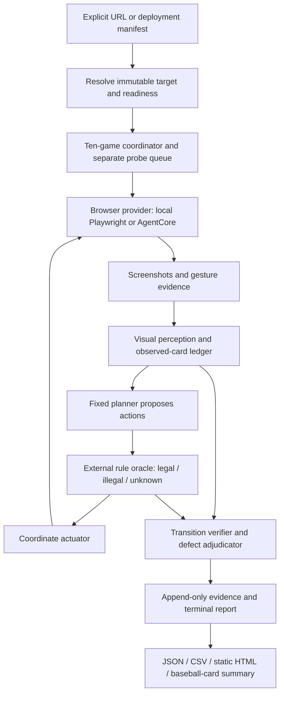

# Dynamic visual gameplay harness — design

Status: proposed architecture, not implemented by this commit. Read [requirements.md](requirements.md), [rule-catalog.md](rule-catalog.md), and [tasks.md](tasks.md) together.

## Architecture

Keep the evaluator on main. Existing `qa-agent.mjs` remains the exploratory entry point while its reusable pieces move behind explicit contracts. Add a new `qa-evaluate.mjs` entry point for controlled evaluation; do not quietly change the meaning of an old training report.



The normal-game planner proposes legal moves; the probe scheduler intentionally requests specific illegal/boundary moves. Both use the same actuator and evidence contracts. The oracle does not import generated application logic. The report renderer consumes saved evidence and does not need an active model/browser.

### Planned modules

| Path | Responsibility |
| --- | --- |
| `scripts/qa-evaluate.mjs` | CLI validation, manifest loading, preflight, run orchestration, exit codes. |
| `scripts/qa/contracts/` | Versioned JSON schemas and strict validation for targets, observations, actions, events, findings, outcomes. |
| `scripts/qa/browser/local.mjs` | Local Chromium context/session lifecycle and capabilities. |
| `scripts/qa/browser/agentcore.mjs` | Remote provider, signed CDP connection, cleanup, session metadata. |
| `scripts/qa/browser/agentcore_bridge.py` | Small optional AWS SDK lifecycle/signing bridge using the official BrowserClient, if the JS SDK spike does not supply an equally supported direct path. Choose one ownership path in the spike, not both. |
| `scripts/qa/observe/` | Screenshot capture, stable-frame detection, OCR/VLM adapter, coordinate transforms, observation reconciliation. |
| `scripts/qa/rules/` | Deterministic three-valued legality/transition oracle and card/category ledger. |
| `scripts/qa/play/` | Fixed planner, visible-action enumeration, memory, loop detection, bounded recovery, probes. |
| `scripts/qa/evidence/` | Append-only journal, artifact hashing, runtime events, incremental report persistence. |
| `scripts/qa/report/` | Aggregation, JSON/CSV/HTML output, evidence links and dashboard payload. |
| `qa/rules/category-solitaire-v1.json` | Reviewed external rule/deck contract from the original README; 13 titles, 73 items, 86 cards. |
| `qa/config/` | Explicit profiles, ten-game schedule, budgets, target-manifest examples. |
| `tests/qa/fixtures/`, `tests/qa/` | Independent visible fixture apps, injected mutations, unit/contract/live integration tests. |

These paths are a proposed implementation map. No new executable or cloud resources are delivered by this plan. Pin all browser, AWS SDK, model, schema, and oracle versions in future run manifests.

## Browser-provider contract

`start(profile) -> handle`; `navigate(handle, target)`; `observe(handle)`; `act(handle, action)`; `runtimeEvents(handle)`; `stop(handle)`; `capabilities()`.

A handle contains a unique episode ID and backend/session identity; credentials and signed headers remain private. Capabilities explicitly state supported browser, touch/keyboard/video/audio capture, viewport/DPR, and replay behavior. Unsupported actions become untested capability gaps, never mouse-event substitutions labeled as touch.

Initialize the run journal before resource creation. Acquire each resource inside a guarded lifecycle, save its identifier immediately, and register cancellation cleanup. Persist a unique per-slot AgentCore client token and owned session name BEFORE StartBrowserSession; reuse the token on uncertain start retries to prevent duplicate sessions. If the start response is lost, reconcile the owned name/token registry against the service before retry/cleanup, and test this orphan-window case. Save evidence after every step. Close page/connection, stop the owned remote session, and finalize reports independently, so one cleanup exception cannot suppress the other operations. A bounded watchdog tracks owned sessions after runner crashes; it must never terminate unrelated sessions.

### AgentCore and `opensearchprod`

Local discovery on 2026-10-14 found AWS CLI `2.35.21`, profile `opensearchprod`, region `us-east-1`. Generating the start-session input skeleton succeeded locally. No STS/service request, authenticated session, permissions test, resource creation, or browser/model execution was performed. Pin compatible CLI/SDK versions after the implementation spike; local CLI parsing is not proof of AWS account access.

AgentCore provides the remote browser, and Playwright connects using its authenticated automation stream. The official BrowserClient examples generate both a WebSocket URL and authentication headers; do not use a bare endpoint as if it were an unauthenticated browser. Keep signed URLs/headers and temporary session tokens out of reports. [AWS Playwright integration](https://docs.aws.amazon.com/bedrock-agentcore/latest/devguide/browser-quickstart-playwright.html)

Production ownership decision: prefer the existing Node Playwright runner with a supported AWS SDK integration. If using the documented Python BrowserClient bridge, it owns start/sign/stop and stays alive until Node finishes. Communicate through a private pipe, inherit the named AWS profile/region, and verify the pinned SDK's custom-browser interface. The runner must not separately launch a second CLI-created session. Contract-test credential refresh, token/session expiry, malformed endpoint responses, and stop-on-cancel. A Python bridge is infrastructure plumbing; game interpretation stays in the same shared JS evaluator.

The following are **future manual smoke-test commands**, not commands run during planning. Use a preconfigured recording-enabled custom browser for recorded suites; `aws.browser.v1` is a simple initial browser smoke-test choice. A custom browser ID, recording bucket/prefix, and execution role are deployment inputs to resolve later.

```bash
aws --profile opensearchprod --region us-east-1 sts get-caller-identity

aws --profile opensearchprod --region us-east-1 bedrock-agentcore start-browser-session \
  --browser-identifier aws.browser.v1 \
  --name category-solitaire-qa-smoke \
  --session-timeout-seconds 1200 \
  --view-port width=1440,height=900

# Record sessionId from the response. Connect through the signed SDK/CDP adapter.
# Stop this exact session in cleanup, including when connection/navigation fails.
aws --profile opensearchprod --region us-east-1 bedrock-agentcore stop-browser-session \
  --browser-identifier aws.browser.v1 \
  --session-id 'REPLACE_WITH_RETURNED_SESSION_ID'
```

The CLI controls lifecycle; it does not plan moves or play ten games by itself. Use `--browser-identifier` from the current command reference rather than copying inconsistent shorthand from older guide snippets. [Start CLI reference](https://docs.aws.amazon.com/cli/latest/reference/bedrock-agentcore/start-browser-session.html), [stop CLI reference](https://docs.aws.amazon.com/cli/latest/reference/bedrock-agentcore/stop-browser-session.html)

For actual suites, allow session lifetime to cover the gameplay cap plus bounded setup/cleanup (proposed 1,800 seconds for a 20-minute game); do not let a 20-minute remote TTL erase a final report at the gameplay boundary. Also enforce a 25-minute hard wall-clock deadline from session allocation, including pauses/setup, leaving cleanup time before the remote TTL. Run sequentially by default; add limited parallelism only after quotas, costs, and reproducibility are validated.

Separate identities: the runner needs lifecycle and automation-stream permissions scoped to the selected browser; provisioning a custom browser/role is a deployment step; the browser execution role needs scoped recording storage/log access. The VLM provider has its own model permissions/configuration. Resolve exact actions/resource ARNs from current AWS docs and deployment policy; do not embed keys or broad account permissions in source. [Browser permissions/lifecycle](https://docs.aws.amazon.com/bedrock-agentcore/latest/devguide/browser-resource-session-management.html)

Enable recordings on a custom browser with a dedicated S3 prefix and lifecycle retention policy; preserve the replay locator with each episode and confirm upload after stopping. App screenshots/events remain first-class local artifacts even when cloud replay is enabled. Replay may contain DOM, network, and console data: retain it for human diagnosis, but do not feed hidden data from those recordings to the visual player/oracle. [AWS recording setup](https://docs.aws.amazon.com/bedrock-agentcore/latest/devguide/browser-session-recording.html)

A public cloud browser can reach public HTTPS branch previews, not the developer's `localhost`. Start with existing deployed previews. Add private-network access only as a separately validated provider configuration. AgentCore Chromium results do not certify Safari behavior; later local WebKit/real-device coverage must be separately labeled.

## Target identity and branch iteration flow

1. Resolve the requested git ref to a full SHA before build. The deployment pipeline emits a target receipt: source SHA/ref, immutable deployment ID, URL, bundle hash, build timestamp, expected rules/deck ID, and build status.
2. Prefer an immutable preview URL per SHA. If an alias is used, check a deployment-owned build receipt before and after every game and stop on change. The receipt is evaluator metadata, not app-specific runtime state.
3. Check reachability, nonblank rendered board, and expected game regions with bounded retries. Do not use `networkidle` as the only ready condition; the app may keep connections open.
4. Refuse dashboard URLs, missing apps, mismatched hashes, or plan-only branches with a clear preflight status. Do not allocate fictional losses to an app that was never built; emit a preflight report with ten slots marked not run and explain the denominator.
5. Read the manifest dynamically for the original variants and the six new Claude experiment branches. Future branches need no hard-coded `BRANCH_URLS` edit. A replacement deck is an explicit external rules fixture, not something guessed from hidden source.
6. After evaluation, attach results to that exact SHA. The deployment/dashboard layer can display “tested older revision” if HEAD changes, never silently attach old results to the newest build.

Illustrative future target record (placeholders, not a ready deployment):

```json
{
  "schemaVersion": 1,
  "branch": "claude.cli.opus-5-5.steering",
  "sourceSha": "FULL_IMPLEMENTED_COMMIT_SHA",
  "deploymentId": "IMMUTABLE_BUILD_ID",
  "url": "https://REPLACE_WITH_REACHABLE_GAME_PREVIEW/",
  "artifactSha256": "BUILD_DIGEST",
  "ruleset": "category-solitaire-v1",
  "deckId": "original-86-cards",
  "ready": false
}
```

## Observation, planning, and independent verdicts

The observer detects source/draft, foundations, tableau columns, face-up title/item labels, visible counters, score, selection, modals, and menu controls. Every fact includes confidence and screenshot/region provenance. `null` stays unknown. Stable IDs in the evaluator refer to observed entities over time; they are not app IDs. Hypotheses about covered cards are kept separate from confirmed facts.

Start with screenshot crops and OCR/VLM object detection. Reconcile observations across frames and check externally known deck vocabulary. Never “correct” an observation merely because the oracle expects a different result; that would conceal actual bugs. Preserve conflicting observations and request another frame/crop. An optional visible-DOM/accessibility-assisted mode can be explored later but is a separately named benchmark configuration and may only consume user-visible information.

The planner receives public rules, current qualified observations, revealed-card history, and previous legal attempts. It does not receive hidden fixture truth, generated game source, other branches' runs, or evaluator defect labels. Pin model/provider/version/settings across target comparisons. Keep planning and judging prompts/contexts separate even when the same provider is used.

The deterministic oracle predicts allowable partial state transitions, including source/destination movement, order, reveals, counters, score, and completion. It evaluates only known preconditions; incomplete card identities or destinations yield unknown. Category deck counts come from the external rule contract, not the app's claimed counter. It must not substitute a reward score or prose “success” for transition evidence.

Actuation records intended and actual coordinates, viewport transform, selection/pickup, intermediate drag frames or video, release, settling window, and final observation. A no-op is a blocked legal action only after reliable preconditions and delivery. Permit at most two bounded actuator retries against a newly observed unchanged board; if the first attempt may have moved state, replan instead of repeating it blindly. If another modality succeeds, preserve the original modality defect rather than erasing it.

A defect needs a causal statement: “rule X expected transition Y after a successfully delivered action, but evidence Z showed transition W.” Reproduction starts a separate probe session or replays the visible route when possible. Never inject app state to force reproduction. If the original randomized state cannot be reproduced, retain an evidence-confirmed single occurrence or a suspected finding, depending on evidence strength; do not claim a reproduced bug.

## Ten normal games and the probe suite

Allocate ten slots before starting. Proposed fixed schedule, reused across branches:

| Slots | Viewport/input profile | Count |
| --- | --- | --- |
| 01–03 | Desktop 1440×900, mouse drag primary | 3 |
| 04–05 | Desktop 1440×900, click-select/click-destination primary | 2 |
| 06–08 | Phone 390×844, touch tap-to-move primary | 3 |
| 09–10 | Phone 390×844, synthesized touch drag primary | 2 |

Use DPR 1 for the initial comparison unless a different fixed setting is preregistered. “Mobile” here is the stated browser's mobile emulation, not a physical-device claim. Fix the schedule, evaluator policy, and resource budgets before branch comparison; report each input stratum as well as the total. Real randomness means these are repeated normal plays, not paired identical deals.

A failed capability preflight marks the affected slots unrun/unsupported and the suite incomplete; do not silently replace touch games with mouse games. In-progress errors count as that slot's outcome. Infrastructure retries keep the same slot/attempt lineage; retain the first failure and all spend, and publish retry results separately from the initial ten rather than selecting a favorable attempt.

The player enumerates actionable visible cards, prioritizes verified legal progress, remembers revealed draft order, avoids repeated no-op moves, and advances source/recycle as needed. Score and visual changes are observations, not the objective function. Bounded search can reason about revealed state; it cannot invent the hidden deal. Repeated board states plus two no-progress stock cycles trigger re-observation/alternative candidate exploration, then the rule-catalog's inconclusive terminal status if exhausted. Never label “unsolvable” without a separate complete-state proof, which this visual-only mode generally cannot provide.

Probe sessions cover the legal/illegal matrix and controls in rule-catalog.md. Reach states via visible play, copy only action recipes/observations, then attempt a selected rule violation. A successful illegal action is a confirmed defect if evidence supports it; stop or reset that probe rather than completing an invalid game. Unreached probe cases are untested. Freeze the probe order/budget and randomize branch order to avoid adapting the test to favor one app.

Audio needs an actual audio recording/measurement capability and user-gesture activation. Menu/mute/restart/quit and end-state probes may intentionally reset a game, so they run separately from normal win attempts. Keyboard/contrast checks are supplemental UX checks; they must not be counted as original-rule violations when absent from the product prompt.

## Data and report contracts

Use versioned JSON schemas, strict booleans/enums, bounded arrays and coordinates, and explicit unknowns. Preserve raw model responses with model/request ID and cost after redacting credentials; malformed output becomes a model/observation failure after bounded retries, never guessed clicks.

| Record | Required fields |
| --- | --- |
| Run | runId (UUID), schema/harness/oracle versions, immutable target receipt, evaluator model/settings, backend/profile label/region, environment, rules/deck hash, schedule, budgets, timestamps, ten slots, probe suite, aggregate counts, status. |
| Game | gameId/index, attempt lineage, normal/probe type, viewport, assigned/actually used input modalities, assisted flag and reason, seed for agent only, initial observed-deal fingerprint, backend session ID, start/stop, terminal outcome/reason, gameplay-completion and initial/current-state solvability status, ledger completeness, win evidence, confirmed/suspected findings, usage, errors, artifacts. |
| Observation | frameId/time/URL, screenshot hash/path, viewport/DPR/scroll, stable status, detected regions/cards/text/counters, confidence/provenance, unknowns/conflicts. |
| Action event | stepId/time, intended semantic action, legal/illegal/unknown oracle decision, preconditions, actual coordinates/modality, delivery evidence, retries, post-observation, transition verdict, runtime errors. |
| Finding | defectId/group, ruleId, class, attribution(s), severity, expected/actual, affected game/step, confirmation/reproduction state, evidence links/hashes, reviewer adjudication. |
| Rule coverage | opportunities, attempted, counts for PASS/FAIL/UNKNOWN/NOT_EXERCISED/NOT_OBSERVABLE, modality and target SHA; friendly labels preserve all five meanings. |

Write `events.jsonl` after every step and checkpoint `run.json` atomically. Produce final `summary.json`, `games.csv`, `defects.csv`, and a static `index.html` from saved evidence. Give artifact paths unique UUID-based names; no collisions from second-resolution timestamps. Report schema version 2 or a new explicit namespace so old heuristic reports cannot be mistaken for validated reports.

Outcome names and counting equations are authoritative in rule-catalog.md. For a suite with at least one established game, display `verified legal wins / 10 planned`, completed/started/unrun counts, and the exact outcome partition. If no game started because preflight failed or the build is not ready, display `Not tested / N/A`, ten NOT_STARTED rows, and `0 of 10 started`; do not present 0/10 as measured win performance. Defect flags can overlap with terminal outcomes; do not add them to the ten-game total. Also show win rate among started games as a separately labeled denominator, never as a replacement for the requested out-of-ten report. Ten games are a descriptive small sample, not a confident universal win probability; repeat batches for stronger comparisons.

The HTML report starts with ten game tiles: terminal state, input profile, duration, rules violated/blocked, and a screenshot. Selecting a tile opens the action timeline and evidence. A rule matrix shows pass/fail/untested by input; a bug table shows illegal accepted versus legal blocked, severity, and reproduction. Keep suspected defects and evaluator failures visually distinct. Provide filters for target SHA and model/style from experiment metadata without changing the blinded evaluation itself.

Reuse GIF rendering for compact previews, but retain unsampled originals and real timestamps. Preserve defect/terminal keyframes and capture gestures/video separately; fixed-delay GIFs are not timing proof. Signed S3/CDP URLs are not durable report links; save artifact IDs and generate authorized links when viewed. Large recordings remain in artifact storage with a declared retention period, not Git.

## Pipeline and dashboard integration

Keep gameplay evaluation a separately bounded stage after successful build/deploy, not inside the existing 120-second code-metric collector. A manual workflow first accepts an immutable target manifest and budgets; later deployment events may enqueue explicit completed SHA receipts. A documentation-only push must not launch gameplay evaluation.

The baseball-card board gains `gameplay` fields keyed by source SHA: verified legal wins/10, wins with violations, games with rule violations, games with blocked legal actions, unique bugs by severity, incomplete/error counts, rule coverage, evaluator/browser identity, and report URL. Keep these separate from code metrics and model generation time. If results are stale or missing, show the status and N/A rather than zeros. Allow viewers to inspect both UI screenshots and the rule-level report.

For CI, use workload identity/OIDC and the same scoped role configuration; the workstation's named AWS profile is a local convenience, not something to copy into GitHub secrets as credentials. A session watchdog and budget guard are part of runner operations before automatic scheduling is enabled.

## Proposed operator interface

These commands describe the future interface; `qa:evaluate` does not exist yet:

```bash
# Validate manifest/budgets without browser/model/network execution.
npm run qa:evaluate -- --targets qa-targets.json --validate-only

# Ten games per target using reachable branch previews.
npm run qa:evaluate -- --targets qa-targets.json --backend agentcore \
  --aws-profile opensearchprod --region us-east-1 --games 10 \
  --schedule qa/config/ten-game-v1.json --mode evaluate

# Same contracts against a locally running app.
npm run qa:evaluate -- --url http://localhost:5173 \
  --source-sha FULL_SHA --backend local --games 10 --mode evaluate

# Separate adversarial rule probes; never part of the ten-game win numerator.
npm run qa:evaluate -- --targets qa-targets.json --suite rules-probes \
  --backend agentcore --aws-profile opensearchprod --region us-east-1
```

Proposed exit codes: 0 = evaluation protocol completed with required coverage and no confirmed app defects (wins/unfinished status still reported); 1 = confirmed app defects; 2 = invalid configuration, incomplete evaluation protocol/required coverage, or evaluator/infrastructure failure. An ordinary INCOMPLETE game at its prescribed play budget can be part of a completed evaluation batch; that game outcome alone does not force exit 2. If both defects and infrastructure failure occur, exit 2 and retain confirmed defects in JSON. “No confirmed bugs” with insufficient coverage must not exit as a complete pass. A failed CI policy gate based on win count is configurable and explicitly separate from the observer's factual results.

## Open implementation decisions and preflight inputs

Resolve during the first implementation stage: reachable immutable preview URLs, external build-receipt mechanism, pinned VLM provider/model and budget, custom AgentCore browser/role/S3 prefix, current service availability/quota/auth in `us-east-1`, JS signing versus documented Python bridge, supported touch/audio capture, artifact retention, and the exact ambiguity choices in rule-catalog.md. These are deployment inputs or validated spikes, not blockers to committing this plan. Default implementation uses local fixtures until the cloud preflight is explicitly run.
