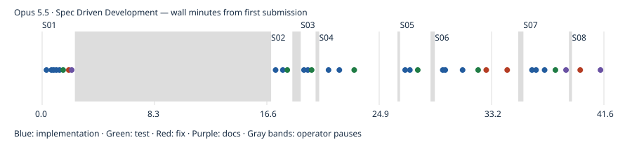

# Opus 5.5 · Spec Driven Development

First-pass build passed; model-authored tests passed. Independent gameplay coverage and UX ratings are reported separately. One pilot run; no overall model ranking. Independent rule probes: 4/4 passed; 0 confirmed rule deviations.

- Prepared: `efd00ed43b5effba6f267d6f6735a52082cb5d19`
- Frozen first-pass result: `78bb4f998d42fb07c4865fc375d613a01da461d2`
- Active time: 25.03 minutes
- Total wall time: 41.56 minutes
- Provider tokens (input + cache creation + cache read + output): 11,049,698
- Incremental commit token estimates: 150,800; final tail shown in final report.
- Build: passed; tests: passed
- Independent gameplay: 9/9 smoke checks; full games untested
- [Structured evidence](claude.cli.opus-5-5.spec.json)

## Limits

One pilot observation, not a model ranking. Human UX ratings, Safari/device testing and ten independently verified complete games were not performed. Unmeasured metrics remain null. Provider list-price estimates are not subscription billing. Actual tokens are summed from each distinct incremental CLI result, including background continuations. Pauses between spec submissions are excluded from active time. Raw CLI transcripts remain local; the reports below are model statements, not independent validation.

## Independent evidence

[Rule probes](evidence/claude.cli.opus-5-5.spec/independent-rules.json) · [Test output](evidence/claude.cli.opus-5-5.spec/test.log) · [Build output](evidence/claude.cli.opus-5-5.spec/build.log) · [Browser checks](evidence/claude.cli.opus-5-5.spec/final-browser.json) · [Phone screenshot](evidence/claude.cli.opus-5-5.spec/final-390.png) · [Desktop screenshot](evidence/claude.cli.opus-5-5.spec/final-1440.png)

Model-authored browser scripts, where retained, are in the evidence folder; they are separate from independent acceptance checks.

## Model checkpoint reports

### S01

**SPEC S01: PASS**

S01 is done. The production build succeeds, the dev app loads in a browser, and the deck has 13 title cards and 73 item cards, 86 in total. HEAD is `8223d8a` and the working tree is clean.

**What's in place**
- **App:** React 19, Vite 8 and MUI 9, with the lockfile committed. The page is a temporary deck preview until S02 builds the board.
- **Deck data:** `src/decks/starterDeck.json` is a flat array of `{id, categoryTitle, itemName}`. A title card is the entry with `itemName: null`. It was generated from the exact list you gave, so spelling and capitalisation match ("Ganymedes", "Sofa bed", "Dress Shirt").
- **IDs:** each one is fixed and unique, for example `king--title` and `beds--sofa-bed`.
- **Swapping decks:** `src/decks/deck.js` checks a deck for unique IDs and exactly one title card per category with at least one item. It works out each category's item count from the data. Decks are listed in `src/decks/index.js`, and `App` also accepts a `deckData` prop.
- **Cards:** `src/components/Card.jsx` draws title cards (category name and item count, e.g. "Aviation / 8 cards"), item cards, and a plain card back.
- **RUNNING.md:** install, dev, test, build and preview commands, plus how to add or swap a deck.

**Checks run**
- `npm install` (one command for runtime packages, one for dev packages) reported 0 vulnerabilities.
- `npm test`: 6 of 6 tests pass. They check that cards have only the three fields, the 13/73/86 counts, unique IDs, the exact categories and items in order, rejection of bad decks, that every displayed title count matches the data, and that a different deck renders.
- `npm run build` succeeds (one JS bundle of about 325 kB, 104 kB gzipped).
- **Dev app:** the server served its pages and modules. Headless Chromium at phone size (390×844) loaded it and found 13 title cards and 73 item cards on the page, with the summary "13 categories, 86 cards" and "Aviation… 8 cards".
- **Repair:** the screenshot showed white text on white cards. Commit `8b97c2f` fixed it, and a second screenshot confirmed the labels are readable. The tests and build were run again after the fix and passed.

**Assumptions and what's not done**
- Title cards are marked by `itemName: null` rather than an extra field, so the JSON keeps exactly the three fields you asked for.
- No board, dealing or game logic yet; that starts with S02.

**Token estimates:** the commit estimates add up to about 24.5k tokens. Reasoning tokens aren't exposed, so they're only roughly included. About 2k tokens of uncommitted tail (this report) aren't in any commit.

Stopping here until you send S02.

### S02

**SPEC S02: PASS**

S02 is done. A new game deals 30 cards to the tableau (4/5/6/7/8) and 56 to the face-down source. Each of the 86 IDs is in exactly one place, each column has one face-up bottom card, the five foundations are empty and the score starts at 0. HEAD is `7260967` and the working tree is clean.

**What's in place**
- **Deal:** `src/game/state.js` shuffles the deck and deals it. Tests can pass in a fixed random generator so the order is repeatable. Each pile is a list of `{id, faceUp}`, with the last entry as the top or exposed card.
- **Board:** `src/components/Board.jsx` stacks the regions in order: the top bar (score top left, cog top right), the source and draft row, five empty foundation slots, then the five-column tableau. The draft shows an empty "Draft" placeholder.
- **Overlapping cards:** cards in a column are absolutely positioned with a calculated `top` offset, so the face-down backs overlap and the face-up card shows in full. Card width scales so five columns fit on a 360px phone.
- **Card faces:** title cards show the title and item count (e.g. "Neck / 4 cards"); item cards show the item text.

**Checks run**
- `npm test`: 13 of 13 tests pass.
  - **Deal tests (5 seeds):** column sizes are 4/5/6/7/8, 30 in the tableau and 56 in the source, the draft is empty, the five foundations are empty, the score is 0, all 86 IDs appear once and match the deck, and only the bottom card of each column is face up.
  - **Board render test:** the four regions appear in the right order, the score reads "Score: 0", the cog is present, the source shows 56 cards and a card back, and the draft shows 0. Each column has the right number of backs and one face at the bottom.
  - **S01 checks** still pass. The 13/73/86 counts and title counts now render the cards directly, because `App` shows the board instead of the deck preview.
- `npm run build` succeeds.
- **Screenshots:** headless Chromium at 360×740 (phone) and 1280×900 (desktop) showed the score and cog at the top, then source and draft, then five dashed foundation slots, then the tableau. The phone view had no horizontal overflow, and the face-up title and item cards were readable.

**Assumptions and what's not done**
- Each game is shuffled at random.
- The cog does nothing yet; the menu comes in S07.
- No drawing, moves or completion yet; those are later specs.
- The overlap is basic; S06 will make covered face-up labels readable.

**Token estimates:** the S02 commit estimates add up to about 18.5k tokens. Reasoning tokens aren't exposed, so they're only roughly included. About 3k tokens of uncommitted tail (screenshot checks and this report) aren't in any commit.

Stopping here until you send S03.

### S03

**SPEC S03: PASS**

S03 is done. Each source click draws exactly one card, the empty source slot appears once all 56 are drawn, and clicking it sends the draft back face down with the former bottom drawn first. HEAD is `55dd633` and the working tree is clean. The clicking was checked only in the test browser simulation (jsdom). I didn't click through it in a real browser.

**What's in place**
- **Draw and recycle logic** (`src/game/state.js`):
  - `drawCard` moves the top source card face up onto the draft.
  - `recycleDraft` works only when the source is empty and the draft isn't. It turns the draft face down and reverses it into the source.
  - Both return the state unchanged when there's nothing to move, so no cards are ever created.
  - `draftTop` returns the only draft card that later moves can use.
- **Source pile** (`src/components/Board.jsx`): a clickable button showing a card back. Once empty it shows a "↻" slot that recycles the draft. When the draft is empty too, the slot reads "Empty" and is disabled.
- **Draft pile:** shows only its top card, marked `draft-top`, or a "Draft" placeholder when empty.

**Checks run**
- `npm test`: 19 of 19 tests pass.
  - **Known small sequence:** a 3-card source (a, b, c with a on top) is drawn one card per call in the order a, b, c. After recycling, the source is face down and drawn again as a, b, c, so the former draft bottom comes first and the former top last.
  - **Edge cases:** recycling does nothing while the source still has cards, and draw and recycle on empty piles do nothing.
  - **Conservation:** four full draw-and-recycle cycles on the real 86-card deal. After every phase the same 86 IDs are on the board, the draw order is the same every cycle, and the source order is restored after each recycle.
  - **UI clicks (jsdom):** 56 clicks each draw exactly one card (counts move 56→0 and 0→56). The empty slot appears, one more click recycles and empties the draft, and the next click draws the card that was drawn first.
  - The S01 and S02 tests still pass.
- `npm run build` succeeds.

**What's not done**
- No tableau or foundation moves yet; the draft top is only marked as available for S04.

**Token estimates:** the S03 commit estimates add up to about 10k tokens. Reasoning tokens aren't exposed, so they're only roughly included. About 2k tokens of uncommitted tail (this report) aren't in any commit.

Stopping here until you send S04.

### S04

**SPEC S04: PASS**

S04 is done. Every allowed and rejected move in the spec is covered by passing tests, illegal moves leave the state unchanged, and the newly exposed card in a vacated column flips face up. HEAD is `80cf239` and the working tree is clean.

**What's in place**
- **Rules** (`src/game/rules.js`):
  - **What can move:** the draft top card, or a face-up tableau card plus everything below it. A run of two or more cards must be all item cards of one category, so a title card moves only when it is the exposed bottom card.
  - **Title cards** can go to an empty column, onto a face-up item of the same category, or into an empty foundation.
  - **Item cards** can go onto a same-category item in the tableau, to an empty column, or into a foundation already holding their title (title-first is required). Category must match.
  - **Runs** can go to an empty column or onto a same-category item. They are rejected at foundations, which the spec only defines for single cards.
  - **Also rejected:** a wrong category, placing onto any title card in the tableau, a face-down card as source or target, a title into an occupied foundation, and a move to the same column. Each rejection returns the same state object with a reason.
  - **After a legal move:** the vacated column's new bottom card flips face up. Cards already face up stay face up.
- **Foundation progress:** `foundationProgress` counts only item cards against the title's total. Completed foundations stay in place, since clearing is S05.
- **Tap interaction:**
  - Tap a face-up card (draft top or tableau) to select it with a yellow outline. Tap a column, card, empty column or foundation to move it there, and tap the selected card again to deselect.
  - **Rejection** shakes the selected card and shows a warning message, and nothing moves.
  - **Foundations** show their top card with a "Title x/y" label above.

**Checks run**
- `npm test`: 48 of 48 tests pass (29 new for S04, plus all the S01–S03 tests).
  - **Rule tests:** each allowed title and item destination, each rejected case, and every rejection proven to leave the state unchanged.
  - **Runs:** moving to an empty column and onto a matching item; rejected onto a wrong category, into a foundation, and when mixed or containing a title.
  - **Draft and reveal:** a moved draft card exposes the next draft top; a vacated face-down bottom flips, and a face-up bottom is left alone.
  - **Tap UI (jsdom, fixed deal):** title into a foundation; item into an empty foundation rejected with the message and nothing moving; the same item then into its title's slot, showing "A 1/3"; an item onto a matching item; a 2-card run to an empty column with the reveal; a wrong category and a face-down tap both rejected.
- `npm run build` succeeds. It ran after the UI commit; later commits changed only test files.
- **Real browser (headless Chromium driven through its DevTools protocol, 390×844):**
  - **Illegal move:** selecting "Scent" and tapping an empty foundation showed the outline, the shake and the warning "An empty holder slot needs a category title card first." The foundation stayed empty and the column stayed at 4 cards.
  - **Legal move:** "Sirocco" moved onto a same-category Winds card. Column counts went from 4/5/6/7/8 to 3/6/6/7/8, and the new bottom card ("Snake") flipped face up.

**Assumptions**
- After a rejection the card stays selected so you can try another destination; tap it again to deselect.
- Foundation cards can't be moved back out.
- The rejection warning is visual only; the error and warning sounds come in S07.
- The simple "Title x/y" label is there now; S05 adds the completion styling.

**Known issue for S06:** when a face-up card is covered by another face-up card, the covered card's centred label is hidden, as the screenshot shows. Making covered labels readable is S06's job.

**Token estimates:** the S04 commit estimates add up to about 34k tokens. Reasoning tokens aren't exposed, so they're only roughly included. About 8k tokens of uncommitted tail aren't in any commit: the real-browser check scripts (kept in `/tmp`, not in the repo) and this report.

Stopping here until you send S05.

### S05

**SPEC S05: PASS**

S05 is done. Completing a category clears its slot, adds exactly 100 points once and frees the slot for another title, and completing two categories gives a score of 200. HEAD is `9816d90` and the working tree is clean.

**What's in place**
- **Completion logic** (`src/game/rules.js`): when an item brings a foundation's collected count up to its category total, that same move clears the slot and adds `COMPLETION_POINTS` (100) to the score. It also returns a `completed` record, which S07 can use for the success sound. A rejected move returns the unchanged state, so it can never add progress or score.
- **Counter:** "Title x/y" above each occupied slot. It counts item cards only, and each category's total comes from its own deck data (King 3, Neck 4, and so on).
- **Glitter** (`Board.jsx`, `App.jsx`): the finished stack glows, tilts and sparkles, then shrinks and fades over 1.2 s. It sits on top of the freed slot without blocking taps, so the slot takes a new title immediately. The score shows at the top left.

**Checks run**
- `npm test`: 51 of 51 tests pass (3 new for S05, plus all the S01–S04 tests).
  - **Completion with starter-deck data:**
    - King progresses 0/3 → 2/3 and keeps its slot.
    - Three rejected cards (wrong category, Neck item into the King slot, a run into a foundation) leave state, progress (2) and score (0) unchanged.
    - King's last item scores exactly 100, clears slot 0 and returns its 4 cards.
    - Neck's 4 items give a completion only on the last one, for a score of 200.
    - The freed slot 0 then accepts the Wine title with the score still 200.
  - **UI (jsdom):**
    - The counter shows "A 0/1".
    - Completing A gives "Score: 100", an empty slot and the glitter.
    - The B title goes straight into the freed slot ("B 1/2").
    - Completing B gives "Score: 200".
    - The glitter is gone after its timer and the score stays 200.
- `npm run build` succeeds.
- **Real browser (headless Chromium, 390×844, small fixed deck mounted through the dev server):** screenshots show the counter "King 1/2" above the slot, then the glittering card with "Score: 100" and the slot empty underneath. After the glitter ended, the Beds title sat in the reused slot with "Beds 0/1".

**What's not done and remaining issues**
- **Not done yet:** the success sound and the win screen (both S07), and card labels covered by other face-up cards (S06).
- **Minor wording:** a one-item category would read "1 cards". The starter deck has no one-item categories, so I left it alone.

**Token estimates:** the S05 commit estimates add up to about 13.5k tokens. Reasoning tokens aren't exposed, so they're only roughly included. About 7k tokens of uncommitted tail aren't in any commit: the browser check scripts (in `/tmp`) and this report.

Stopping here until you send S06.

### S06

**SPEC S06: PASS**

S06 is done. Dragging and tapping give identical results for the same valid and invalid moves, matching item runs move as a unit, and covered face-up cards keep a readable label. HEAD is `72191e4` and the working tree is clean.

**What's in place**
- **Drag and drop** (`@dnd-kit/core`, in `Board.jsx`):
  - **What drags:** the draft top card and face-up tableau cards. A tableau card carries itself plus everything below it. Face-down cards, and runs the rules won't allow, can't be dragged.
  - **Drop targets:** all five tableau columns (each with a little extra space below the cards) and all five foundations. The drop target is whatever is under the pointer or finger.
  - **Sensors:** mouse dragging starts after 5 px of movement, so ordinary clicks still work as taps. Touch dragging starts after a 150 ms press, so the page can still scroll.
  - **During a drag** the card or run follows the pointer and the originals fade.
  - **Rejected drops** (including drops on empty space) shake the card, show the same message as a rejected tap and animate back. Dropping back on the starting column cancels quietly.
- **Shared move path:** tap and drag both call one `attemptMove(from, to)` in `App.jsx`, so they can't disagree. Tap-to-move from S04 is unchanged.
- **Overlapping cards:** cards are absolutely positioned with a calculated `top` offset. A face-up card covered by another shows a small label along its top edge (the item name, or title and count); only the bottom card shows the full face. Cards stay face up when moved onto other face-up cards.

**Checks run**
- `npm test`: 57 of 57 tests pass (6 new for S06, plus all the S01–S05 tests).
  - **Tap vs drag (jsdom, with mocked element positions):** the same 9-step scenario runs once by tapping and once by dragging, and the board matches after every step. The 3 invalid steps leave the board unchanged and give the same message in both modes. The 6 valid steps include a 2-card run moved to an empty column twice.
  - **Face-down cards** can't be dragged or tapped into a move.
  - **A drop on empty space** bounces back with no change.
  - **Draft top card**, by tap and by drag: rejected into an empty foundation, then moved to a matching column; the draft empties.
  - **Stacked cards:** the top offsets increase down a column, every card is absolutely positioned, covered face-up cards show their labels, and the bottom card shows only its full face.
- `npm run build` succeeds.
- **Real Chromium, 360×740 phone and 1280×900 desktop, with real mouse and touch input:** the same sequence ran on both sizes and gave the same results.
  - Mouse: invalid drop into an empty foundation (rejected), title into a foundation, item onto item, 2-card run to an empty column.
  - Touch: item into a foundation, wrong-category drop rejected ("Hammock does not belong to King."), item onto item.
  - Measured styles were `position: absolute` with `top` values of 0 / 19.3 px on the phone and 0 / 28.8 px on desktop.
  - Screenshots show the run preview with its covered "Orb" label, the bounce-back message, and the final stacks labelled "Hammock" and "Orb". On the phone, the source, draft, five foundations and five columns all fit with no overlap.

**Problems found and fixed**
- `9c1ee81`: dnd-kit ignores clicks for about 50 ms after a drag ends, which broke the tests that tap right after a drag. The test drag helper now waits that out.
- `72191e4`: the real-browser screenshots showed tableau cards wider than their columns. I had set `box-sizing: content-box` on columns for extra drop space, and CssBaseline passed it down to the cards. The extra space now comes from the column height instead.

**Process note:** I broke the commit rule once. I ran the tests and build on the drag-and-drop changes before committing them, then committed straight afterwards as `8a8c0f8`.

**Assumptions and limits**
- Touch input was checked with Chromium's simulated touch events, not on a physical phone.
- No keyboard dragging; it wasn't asked for.
- My extra click guard after drags is redundant with dnd-kit's own protection, but harmless.

**Token estimates:** the S06 commit estimates add up to about 35.5k tokens. Reasoning tokens aren't exposed, so they're only roughly included. About 12k tokens of uncommitted tail aren't in any commit: the browser check scripts (in `/tmp`, not in the repo), the screenshot reviews and this report.

Stopping here until you send S07.

### S07

**SPEC S07: PASS**

S07 is done. Illegal moves and completed categories play their sounds, mute silences everything, Restart and Play Again deal fresh games, Quit ends play cleanly, and the win modal works. Clearing all 13 starter categories scores 1300. HEAD is `63e74d2` and the working tree is clean. Sound generation was checked by counting the oscillators the browser created; I didn't listen to the sounds.

**What's in place**
- **Sounds** (`src/audio/sounds.js`): three effects generated with Web Audio oscillators, with no audio files. The audio context is created on first use, and when sound is off nothing is generated.
  - **Error:** a low square-wave buzz, for illegal title-card moves ("make an error sound").
  - **Warning:** a short triangle-wave double beep, for illegal item-card moves ("generate a warning noise").
  - **Success:** a rising four-note arpeggio, when a category completes.
- **Cog menu:** Restart, "Turn sound off/on" and Quit. The score stays top left.
- **Quit** (my interpretation, since the prompt doesn't say where it goes): it ends the current game and replaces the board with a "Game ended" screen. That screen shows the final score and a New Game button. A web page can't reliably close its own tab. This is also noted in RUNNING.md.
- **Win:** `isWon` is true only when the source, draft, tableau and all foundations are empty. The modal shows "Game Over - You Win!", "Final score: N" and a Play Again button. Restart, Play Again and New Game all deal a fresh shuffled game with score 0.

**Checks run**
- `npm test`: 64 of 64 tests pass (7 new for S07, plus all the S01–S06 tests).
  - **Sound player (fake audio context):** each effect creates its notes; when disabled, all three effects create nothing; the context is created only once, on first use.
  - **Full clear:** all 13 starter categories run through a foundation. That gives 13 completions and a score of 1300. The game isn't won at any point before the last card, even with a card sitting in the draft. It is won after the last card.
  - **No false wins:** a single card left in the source, draft, tableau or a foundation means no win.
  - **In the app (fake player injected):** a full small game plays error, warning, success, success in that order. The modal doesn't appear at "Score: 100" with cards left, and appears at the end with "Final score: 200". Play Again resets the score, foundations and columns.
  - **Mute** via the menu: no sounds at all through a full game, and the win still happens.
  - **Restart** resets the score and piles.
  - **Quit** shows the end screen with no board and no win modal; New Game gives a fresh board.
- `npm run build` succeeds.
- **Real Chromium (360×740, real Web Audio; I counted oscillators by wrapping the browser's `createOscillator`):**
  - Sound on: an illegal title created 2 oscillators, an illegal item 2 more, completing Beds 4 more, and the final completion 4 more.
  - Muted: an illegal title created nothing.
  - The modal read "Game Over - You Win! / Final score: 200 / PLAY AGAIN". Play Again closed it with "Score: 0" and 4 cards back in column 0.
  - Quit showed the end screen, and there were no page errors.
  - Screenshots of the menu and the win modal look correct.

**Assumptions**
- The sound setting lasts for the session across restarts but isn't saved.
- There's no separate sound for the win itself; the final completion plays the success sound.

**Token estimates:** the S07 commit estimates add up to about 22k tokens. Reasoning tokens aren't exposed, so they're only roughly included. About 6k tokens of uncommitted tail aren't in any commit: the browser check script (in `/tmp`) and this report.

Stopping here until you send S08.

### S08

**SPEC S08: PASS**

The whole app is integrated and every requirement in the original prompt is implemented and checked. A full starter-deck game won in a real browser with a score of 1300, and the production build runs on a phone and on desktop. HEAD is `78bb4f9` and the working tree is clean. Nothing was pushed or deployed.

**Integration fixes in S08 (each its own commit)**
- `5b2256b`: a title card for a one-item category read "1 cards". Changed to "1 card". The starter deck wasn't affected, but swapped-in decks could be.
- `78bb4f9`: RUNNING.md said "Node 20+". The app itself runs and builds on Node 20.19+ or 22.12+, but the test tools (Vitest and jsdom) need Node 22.22+ or 24.15+. RUNNING.md now says so.

**Requirements and where they were checked**

| Requirement | Evidence |
|---|---|
| React/Vite/MUI; swappable `id`/`categoryTitle`/`itemName` JSON deck; exact starter deck | S01 tests: 13 titles, 73 items, 86 unique IDs, exact spellings and order, alternate deck renders |
| Source draws one card; recycle reverses the draft back into the source | S03 tests: known 3-card order, card count conserved over 4 full cycles, click tests |
| 4/5/6/7/8 deal, bottom card face up, reveal after a move | S02 and S04 tests; checked again in the S08 preview |
| Legal title, item and run moves; illegal moves bounce back with a warning | S04 rule tests; S06 jsdom tests and real-browser drags |
| Drag-and-drop and tap-to-move give identical results | S06 tap/drag comparison, plus real mouse and touch drags |
| Overlapping cards positioned absolutely with readable covered labels | S06 tests plus measured `position: absolute` and `top` values in Chromium |
| x/y counters, glitter, success sound, 100 points, slot reuse | S05 and S07 tests; the S08 full game |
| Score top left; menu with Restart, Quit, Sound off | S07 tests and screenshots |
| Web Audio only, no audio files | No audio files or `<audio>`/`new Audio(` anywhere; the oscillator code is in the production bundle |
| Win only when everything is cleared; final score; Play Again | S07 tests; the S08 full game |

**Checks run in S08**
- `npm test`: 64 of 64 tests pass in 7 files.
- **Clean `npm run build`:** succeeds; the JS bundle is about 477 kB (150 kB gzipped).
- **Full starter-deck game in real Chromium (360×740, real mouse clicks):**
  - I built a fixed random generator so the 86-card deal came out in a known, winnable order (4/5/6/7/8 tableau, 56 in the source).
  - The game took 86 moves and 56 draws, and the score rose 0 → 100 → … → 1300 with no gaps.
  - It created 52 oscillators, matching 13 success chimes of 4 notes each.
  - The modal read "Game Over - You Win! / Final score: 1300 / PLAY AGAIN", and there were no page errors.
- **Production preview (`vite preview`) at 360×640 and 1366×768:**
  - A random deal with score 0, cog present, source 56, columns 4/5/6/7/8, 5 face-up cards and 5 empty foundations.
  - Three draws moved 3 cards from the source to the draft.
  - No horizontal scrolling at either size, and the screenshots look correct.

**Assumptions** (also noted in RUNNING.md or earlier reports)
- **Quit** ends the game and shows an end screen with the final score and a New Game button.
- **Sounds:** an illegal title-card move plays the error sound and an illegal item-card move plays the warning sound.
- **Runs** can't go into foundations.
- **Foundation cards** can't be moved back out.
- **Sound setting** lasts for the session but isn't saved.

**Missing coverage and remaining issues**
- No testing on a physical phone or in Safari or Firefox. Touch was checked only with Chromium's simulated touch events.
- The full-game win used a fixed, favourable deal; random deals were only spot-checked.
- I didn't listen to the sounds. I only checked that the browser created the right number of oscillators.
- There's no keyboard drag-and-drop, and no check that a random deal is winnable; neither was asked for.
- No known defects remain.

**Token estimates:** the S08 commit estimates add up to about 5.5k tokens. The browser checks and this report add about 12k tokens of uncommitted tail. Reasoning tokens aren't exposed, so all figures are rough.

## Commit timeline

Markers record completed commits, not pure model latency. Full timestamps and subjects are in the structured evidence.
