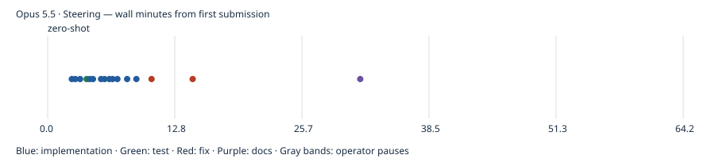

# Opus 5.5 · Steering

First-pass build passed; model-authored tests passed. Independent gameplay coverage and UX ratings are reported separately. One pilot run; no overall model ranking. Independent rule probes: 3/4 passed; 1 confirmed rule deviations.

- Prepared: `b29e7a1e16ccdc126087ca88df38b687c9d428e9`
- Frozen first-pass result: `d35402f3a954678ec205c5eb55dde49d15ec4142`
- Active time: 64.16 minutes
- Total wall time: 64.16 minutes
- Provider tokens (input + cache creation + cache read + output): 5,045,932
- Incremental commit token estimates: 89,000; final tail shown in final report.
- Build: passed; tests: passed
- Independent gameplay: 9/9 smoke checks; full games untested
- [Structured evidence](claude.cli.opus-5-5.steering.json)

## Limits

One pilot observation, not a model ranking. Human UX ratings, Safari/device testing and ten independently verified complete games were not performed. Unmeasured metrics remain null. Provider list-price estimates are not subscription billing. Actual tokens are summed from each distinct incremental CLI result, including background continuations. Pauses between spec submissions are excluded from active time. Raw CLI transcripts remain local; the reports below are model statements, not independent validation.

## Independent evidence

[Rule probes](evidence/claude.cli.opus-5-5.steering/independent-rules.json) · [Test output](evidence/claude.cli.opus-5-5.steering/test.log) · [Build output](evidence/claude.cli.opus-5-5.steering/build.log) · [Browser checks](evidence/claude.cli.opus-5-5.steering/final-browser.json) · [Phone screenshot](evidence/claude.cli.opus-5-5.steering/final-390.png) · [Desktop screenshot](evidence/claude.cli.opus-5-5.steering/final-1440.png)

Model-authored browser scripts, where retained, are in the evidence folder; they are separate from independent acceptance checks.

## Model checkpoint reports

### zero-shot

Waiting on the bot run; I'll pick up when it finishes.

### zero-shot

Bot rerun in progress (two games); I'll report once it finishes.

### zero-shot

The Category Solitaire app is built and committed (HEAD `d35402f`, working tree clean). In a browser it played a full game through to the "Game Over - You Win!" modal, and "Play again" started a new game without a page reload.

## What works
- **Deck swapping:** the deck is a JSON array of `{id, categoryTitle, itemName}` in `src/deck/starterDeck.json`. An entry with `itemName: null` is that category's title card. To use another deck, point `src/deck/index.ts` at a different JSON file. Item counts, "x/y" counters, completion and the win check all come from the data. A malformed deck is rejected with an error.
- **Rules:** these live in `src/game/engine.ts` as functions that don't touch the UI:
  - Columns are dealt 4/5/6/7/8 with only the bottom card face up.
  - The source deck deals one card at a time. When it's empty, tapping the empty slot flips the draft pile back so the old bottom card is drawn first.
  - Title and item placement follow the prompt's rules. A stack of same-category item cards moves as one unit.
  - The new bottom card of a column flips face up after a move.
  - A finished category glitters, clears, frees its slot and awards 100 points once.
  - The win is decided from the whole game state.
  - An illegal move leaves cards, face-up state and score unchanged.
- **Drag and tap share one path:** dragging and tap-then-tap go through the same validation. Touch drag starts after a short press-and-hold so normal swipes don't grab cards. The keyboard route is Tab to a card, Enter, Tab to a destination, Enter.
- **Feedback:** the selected card is outlined and raised, valid destinations get a dashed outline, and an invalid move shakes the card. A status line, announced to screen readers, shows a text message for every event, so nothing relies only on colour or sound.
- **Sound:** error, warning and success sounds are generated with Web Audio and start after the first tap or key press. Mute is respected.
- **Menu:** the cog menu restarts, toggles sound, or quits to a "Game ended" screen with a "Start a new game" button.

## Checks I ran
- **Unit tests:** `npm test` passes 16 tests. They cover deck validation and unique IDs, dealing and card conservation, source-pile recycling order, legal and illegal moves with unchanged state, stacks, reveal, completion, scoring once, a freed slot accepting a new title, and the win condition.
- **Build:** `npm run build` (type check plus Vite build) passes.
- **Screen sizes:** I took screenshots at 360, 390, 768 and 1440px wide. All five columns fit with no sideways page scrolling.
- **Scripted browser checks:**
  - Tap and mouse drag gave the same result.
  - Touch press-and-hold drag worked, and the keyboard route worked.
  - Draw, recycle, mute, restart, quit and new-game-after-quit all worked.
  - An illegal drag to a slot returned the card with a message.
- **Automated play-throughs (UI only):** these surfaced two bugs, both fixed in their own commits:
  - Screen-reader drag announcements read out internal card IDs.
  - Cards that can't be dragged were marked disabled even though tapping them explains why they can't move.

  After the fixes, one game completed all 13 categories (score 1300) and reached the win modal. Another reached a dead end with all five slots holding unfinished categories; that came from the bot's simple strategy, not an app error. No console errors appeared in any final run.

## Limitations
- **Not tested in the browser:** reduced-motion behaviour (it's handled in CSS), actually hearing the sounds, and a restart during the glitter animation. That last one is handled in code by clearing pending effects on every new deal.
- **Touch scrolling:** my simulated fast swipe did not start a drag, but it also didn't show the page scrolling, so swipe-to-scroll isn't confirmed.
- **Covered cards:** a card covered by another can only be grabbed by its visible top label strip, about 23px tall on phones, which is smaller than the ideal 44px touch target.
- **No winnability guarantee:** the shuffle can produce a game that can't be won, and the app doesn't detect a stuck game.
- **One process slip:** I type-checked the accessibility/favicon fix (`ada802e`) once before committing it.

## Token estimates
Commit estimates are rough guesses. Reasoning tokens aren't fully visible to me. I estimate about 15k tokens of uncommitted work after the last commit, mostly the play-through runs, screenshot review and this report.

## Commit timeline

Markers record completed commits, not pure model latency. Full timestamps and subjects are in the structured evidence.
