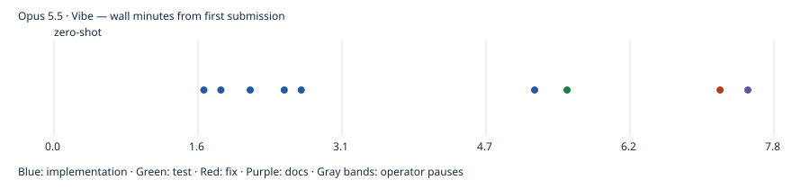

# Opus 5.5 · Vibe

First-pass build passed; model-authored tests passed. Independent gameplay coverage and UX ratings are reported separately. One pilot run; no overall model ranking. Independent rule probes: 2/4 passed; 2 confirmed rule deviations.

- Prepared: `39f60b1bc80bb663cfa616f73eeae99e92ff8d98`
- Frozen first-pass result: `bb12a9284674922a807bf64bb5ba143f3be859de`
- Active time: 7.76 minutes
- Total wall time: 7.76 minutes
- Provider tokens (input + cache creation + cache read + output): 1,348,923
- Incremental commit token estimates: 74,500; final tail shown in final report.
- Build: passed; tests: passed
- Independent gameplay: 9/9 smoke checks; full games untested
- [Structured evidence](claude.cli.opus-5-5.vibe.json)

## Limits

One pilot observation, not a model ranking. Human UX ratings, Safari/device testing and ten independently verified complete games were not performed. Unmeasured metrics remain null. Provider list-price estimates are not subscription billing. Actual tokens are summed from each distinct incremental CLI result, including background continuations. Pauses between spec submissions are excluded from active time. Raw CLI transcripts remain local; the reports below are model statements, not independent validation.

## Independent evidence

[Rule probes](evidence/claude.cli.opus-5-5.vibe/independent-rules.json) · [Test output](evidence/claude.cli.opus-5-5.vibe/test.log) · [Build output](evidence/claude.cli.opus-5-5.vibe/build.log) · [Browser checks](evidence/claude.cli.opus-5-5.vibe/final-browser.json) · [Phone screenshot](evidence/claude.cli.opus-5-5.vibe/final-390.png) · [Desktop screenshot](evidence/claude.cli.opus-5-5.vibe/final-1440.png)

Model-authored browser scripts, where retained, are in the evidence folder; they are separate from independent acceptance checks.

## Model checkpoint reports

### zero-shot

The first pass of the Category Solitaire app is done and committed. The working tree is clean and HEAD is `bb12a92`. Unit tests and the production build pass, and I tested taps and drags in a headless browser. One drag bug turned up there and is fixed. I haven't tried it on a real touch device yet.

**What works:**
- **Swappable decks:** a deck is a JSON array of `{id, categoryTitle, itemName}` in `src/decks/starterDeck.json`. The category title cards, with their card counts, are built automatically from the unique `categoryTitle` values. To use a new deck, register it in `src/decks/index.js`.
- **Code layout:** all the game rules are in plain functions in `src/game/engine.js`, kept separate from the React/MUI screens.
- **Source deck and draft pile:** tap the deck to deal one card. When it's empty, an empty slot appears; tapping it flips the draft pile back over in reverse order.
- **Five foundation slots:** each filled slot shows the category name and an "x/y" counter above it. A finished category glitters, plays the success sound, adds 100 points and frees the slot.
- **Play area:** five columns of 4–8 cards, with only the bottom card face up. The new bottom card flips automatically when a card is moved off it. Stacked cards overlap using absolute `top` offsets, so a small label shows at the top of each covered card.
- **Move rules:**
  - Title cards can go to an empty column, onto an item of their own category, or into an empty slot.
  - Item cards can go onto items of their own category, into an empty column, or onto their category's slot once the title card is there.
  - A run of same-category items moves as one unit.
- **Drag and tap:** cards can be dragged (`@dnd-kit/core`, mouse and touch). An illegal drop animates back to where it started. Tap-to-move also works: tap a card, then tap a destination. An illegal tap makes the card shake.
- **Sounds:** generated with Web Audio. Illegal moves in the play area give an error buzz, illegal moves onto a slot give a warning beep, and completing a category plays a chime.
- **Screen:** score at the top left. The cog menu has restart, sound on/off and quit. A "Game Over - You Win!" dialog shows the final score with a play-again button.

**Checks run:**
- `npx vitest run`: 9 of 9 tests pass. They cover dealing, flipping the pile back, the move rules, moving a run, revealing the next card, and clearing a category to win.
- `npx vite build`: succeeds.
- Headless Chromium screenshots at 390px and 1280px wide: layout looks right.
- Scripted browser tests:
  - **Taps:** drawing, tapping to select, the illegal-tap shake, flipping the pile back, and the menu items all worked with no console errors.
  - **Drags:** the first run showed a successful drag wasn't landing. A CSS rule was positioning the draft-pile cards below their slot. I fixed it in its own commit (`0dce506`). After that, an illegal drag bounced back and dragging a title card onto a slot showed "Ceramic 0/5".

**Not tested:** a full game played through to the win dialog in the browser (the win logic is unit-tested), dragging a stack of cards in the browser, real touch devices, and whether the sounds actually play.

**Choices I made where the prompt didn't say:**
- Nothing can be placed on a title card in the play area, so it is always the last card of a stack.
- Cards can't be taken back out of a slot.
- A stack of matching items can be dropped onto its category's slot in one move.
- Dropping a card somewhere that isn't a target bounces it back without a sound.
- Quit shows a "Thanks for playing" screen with a button to start a new game.
- Valid destinations aren't highlighted while you drag or select, because that would give away which items belong to which category.

**Token estimates:** each commit's `[tokens-est:N]` is a rough guess at input plus output tokens. Reasoning tokens are only partly included, since I can't see their exact count. About 4,000 tokens of uncommitted work came after the last commit (checking status, writing this report). RUNNING.md has the run commands (`npm install`, `npm run dev`, `npm test`).

## Commit timeline

Markers record completed commits, not pure model latency. Full timestamps and subjects are in the structured evidence.
