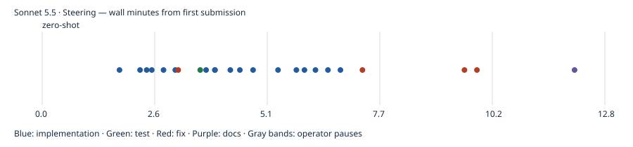

# Sonnet 5.5 · Steering

First-pass build passed; model-authored tests passed. Independent gameplay coverage and UX ratings are reported separately. One pilot run; no overall model ranking. Independent rule probes: 2/4 passed; 2 confirmed rule deviations.

- Prepared: `5483a77e99c0de077e03c2446b25659cde870259`
- Frozen first-pass result: `649c5f574537c32547defc16c5dcdc61b2c72283`
- Active time: 12.78 minutes
- Total wall time: 12.78 minutes
- Provider tokens (input + cache creation + cache read + output): 3,428,487
- Incremental commit token estimates: 62,000; final tail shown in final report.
- Build: passed; tests: passed
- Independent gameplay: 9/9 smoke checks; full games untested
- [Structured evidence](claude.cli.sonnet-5-5.steering.json)

## Limits

One pilot observation, not a model ranking. Human UX ratings, Safari/device testing and ten independently verified complete games were not performed. Unmeasured metrics remain null. Provider list-price estimates are not subscription billing. Actual tokens are summed from each distinct incremental CLI result, including background continuations. Pauses between spec submissions are excluded from active time. Raw CLI transcripts remain local; the reports below are model statements, not independent validation.

## Independent evidence

[Rule probes](evidence/claude.cli.sonnet-5-5.steering/independent-rules.json) · [Test output](evidence/claude.cli.sonnet-5-5.steering/test.log) · [Build output](evidence/claude.cli.sonnet-5-5.steering/build.log) · [Browser checks](evidence/claude.cli.sonnet-5-5.steering/final-browser.json) · [Phone screenshot](evidence/claude.cli.sonnet-5-5.steering/final-390.png) · [Desktop screenshot](evidence/claude.cli.sonnet-5-5.steering/final-1440.png)

Model-authored browser scripts, where retained, are in the evidence folder; they are separate from independent acceptance checks.

## Model checkpoint reports

### zero-shot

The bot run is still going (6 games with menu restarts). I'll check the results when it finishes.

### zero-shot

The bot's output file hasn't changed since I last read it. The run is still in progress, and the monitor on it will notify me when it finishes. I'll stop here until that notification arrives.

**State so far** (HEAD `649c5f5`, all work committed):
- **Rules engine:** deck builder, dealing, draw/recycle, move validation, group moves, reveal, scoring and win are all done. 19 vitest rule tests passed.
- **UI and audio:** the tableau, foundations, stock and draft pile, drag and tap controller, cog menu, win dialog, quit screen and Web Audio effects are all built. `vite build` succeeds.
- **Browser checks so far** (Playwright against a Chromium build):
  - No horizontal overflow at 360, 390, 768 and 1440px.
  - Bot games using tap and drag ran with no unexpected illegal-move rejections.
  - Illegal-move probes gave the expected error message with the board unchanged.
- **Fixes along the way:**
  - Overlapped labels were hidden because a button vertically centres its content.
  - Long item names broke mid-word.
  - A favicon 404 was causing a console error.
- **Not yet verified:**
  - A category completing in the browser (glitter, +100, slot freed).
  - The win modal.
  - Menu restart, quit and mute.
  - A keyboard-only run.
  - Touch emulation.
  - Layout at 768 and 1440 beyond the overflow check.

The one bot game I looked at stalled at 0 points because all five foundation slots held other categories. That's a property of the game, not a bug, but it means the completion and win flows still need a dedicated check.

### zero-shot

The solitaire app is built and committed (HEAD `649c5f5`, clean tree). Most of it checked out, but I never saw a full win, so the "Game Over - You Win!" modal is untested.

The prompt's gameplay is all implemented, including drag-and-drop with `@dnd-kit/core` and tap-to-move through the same move path.

## What was checked

| Check | Result |
|---|---|
| `npm test` (vitest, 19 rule tests) | Passed. Covers deck validity and uniqueness, 4/5/6/7/8 dealing, draw and recycle order, legal and illegal moves, group moves, reveal, category clear scoring once, and victory. |
| `vite build` | Succeeds. |
| Page overflow at 360, 390, 768 and 1440px | None. |
| Playwright bot (tap and drag, Chromium) | 534 moves with no unexpected illegal-move rejections. Five categories completed at +100 each, reaching 500 points. No console errors. |
| Illegal moves (bot probes, tap and drag) | Showed an "Illegal move" message and left the board unchanged. |
| Restart via the cog menu | Reset the score in the bot run. |
| Mute, quit and new game | Toggled and navigated correctly. |
| Keyboard select | Enter on the draft card selected it (the status text showed "Selected Bouquet…"). |

## Not verified
- **Win modal:** the bot never won a game, so I haven't seen the modal or Play Again.
- **Reuse of freed foundation slots:** the bot's five completions don't prove it.
- **Touch behaviour:** touch-drag and tap-versus-drag were not tested on touch emulation or a real device.
- **Drop animation:** I didn't visually confirm the bounce-back after a rejected drop or the lack of one after an accepted drop.
- **Layout:** I only looked at screenshots at 360 and 390px. At 768 and 1440px I checked only that nothing overflows.
- **Audio:** the sounds are generated procedurally and I never heard them.
- **Keyboard:** I only confirmed selecting a card, not a full keyboard-only move.

## Process notes
- Two bugs found in the browser were fixed in their own commits: peek labels hidden by button vertical centring, and a favicon 404. I also made a small commit to stop long item names breaking mid-word.
- I ran the first vitest pass before committing the test file, which breaks the commit-before-test rule.
- The `[tokens-est]` values are rough estimates. Reasoning tokens aren't exposed to me. Uncommitted read-only and debugging work at the end is roughly 15–20k tokens.
- I ran the browser checks with a temporary `playwright-core` install in `/tmp`, so no browser-test dependency was added to the repo.
- The only known gameplay issue is a deadlock the game allows: once all five foundation slots hold other categories, a title card has nowhere to go. That is a property of the rules, not a bug.

Run instructions are in `RUNNING.md`.

## Commit timeline

Markers record completed commits, not pure model latency. Full timestamps and subjects are in the structured evidence.
