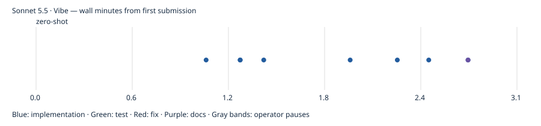

# Sonnet 5.5 · Vibe

First-pass build passed; model-authored tests unavailable. Independent gameplay coverage and UX ratings are reported separately. One pilot run; no overall model ranking. Independent rule probes: 3/4 passed; 1 confirmed rule deviations.

- Prepared: `c96cd0227e4fb94a04a2db795184d3ad545cc11d`
- Frozen first-pass result: `f3176514dd0df6e5ee36ae319df8e359f15aa5c1`
- Active time: 3.06 minutes
- Total wall time: 3.06 minutes
- Provider tokens (input + cache creation + cache read + output): 291,846
- Incremental commit token estimates: 26,400; final tail shown in final report.
- Build: passed; tests: unavailable
- Independent gameplay: 9/9 smoke checks; full games untested
- [Structured evidence](claude.cli.sonnet-5-5.vibe.json)

## Limits

One pilot observation, not a model ranking. Human UX ratings, Safari/device testing and ten independently verified complete games were not performed. Unmeasured metrics remain null. Provider list-price estimates are not subscription billing. Actual tokens are summed from each distinct incremental CLI result, including background continuations. Pauses between spec submissions are excluded from active time. Raw CLI transcripts remain local; the reports below are model statements, not independent validation.

## Independent evidence

[Rule probes](evidence/claude.cli.sonnet-5-5.vibe/independent-rules.json) · [Test output](evidence/claude.cli.sonnet-5-5.vibe/test.log) · [Build output](evidence/claude.cli.sonnet-5-5.vibe/build.log) · [Browser checks](evidence/claude.cli.sonnet-5-5.vibe/final-browser.json) · [Phone screenshot](evidence/claude.cli.sonnet-5-5.vibe/final-390.png) · [Desktop screenshot](evidence/claude.cli.sonnet-5-5.vibe/final-1440.png)

Model-authored browser scripts, where retained, are in the evidence folder; they are separate from independent acceptance checks.

## Model checkpoint reports

### zero-shot

The first pass of the game is built and committed. `npm run build` succeeds. I haven't run it in a browser, so drag-and-drop, tap-to-move, the sounds, the glitter and the win dialog are untested.

**HEAD:** the `[kind:docs]` commit that added `RUNNING.md`. I didn't run `git log` after it, so the short hash isn't confirmed.

**What's in place:**
- **Deck:** it's a JSON array of `{id, categoryTitle, itemName}` in `src/decks/starter.json`, and a title card has `itemName: null`. To swap decks, repoint `src/decks/index.js`.
- **Layout:** the source deck is face down, with an empty slot that recycles the draft pile in reverse order. Below it are five foundation slots, then the five tableau columns dealt 4 to 8 cards. Only each column's bottom card starts face up, and the new bottom card flips automatically after a move.
- **Rules:**
  - Title cards go to an empty column, onto an item of their category, or into an empty foundation slot.
  - Items go onto same-category items, an empty column, or a foundation slot holding their title.
  - Same-category runs move as one unit, and illegal moves bounce back with a sound.
- **Foundation:** each pile shows a "Title x/y" counter above it. A completed category glitters, plays a success sound, awards 100 points and frees the slot.
- **Input:** drag-and-drop uses `@dnd-kit/core`, with a short press-and-hold for touch. Tap-to-move works too: tap a card, then tap a destination.
- **UI:** the score is top left, and the cog menu has Restart, Sound toggle and Quit. Quit shows a "Thanks for playing!" screen with a New Game button. Sound effects are generated with the Web Audio API. Clearing all cards shows the "Game Over - You Win!" dialog with the final score and Play Again.
- **Stack display:** stacked cards overlap using absolute positioning with a calculated `top` offset. The bottom card shows its full face and the cards above it show a smaller top strip.

**Checks I ran:**
- The production build succeeded.
- A small Node script confirmed the deal: 4/5/6/7/8 columns, 56 cards in the source deck, and only each bottom card face up.
- The same script confirmed that drawing works and that recycling the draft pile puts the oldest card on top of the source deck.
- The move rules and the clearing logic were never exercised.

**Assumptions:**
- The deck has 86 cards, with 13 title cards and 73 item cards.
- Dropping a card on nothing snaps it back silently. Dropping it on an invalid target plays the error sound.
- Illegal moves into a foundation slot play the warning and error sounds together.
- There is no deadlock detection, so a game can be unwinnable.

**Not done:** there are no automated tests and no real-device mobile testing. `applyMove` in `src/game.js` has a leftover no-op line (`cards.length = moved.length`) that I didn't remove.

I estimated roughly 4k tokens of uncommitted reasoning and read-only work after the last commit. Reasoning tokens weren't exposed, so that figure is an estimate.

## Commit timeline

Markers record completed commits, not pure model latency. Full timestamps and subjects are in the structured evidence.
